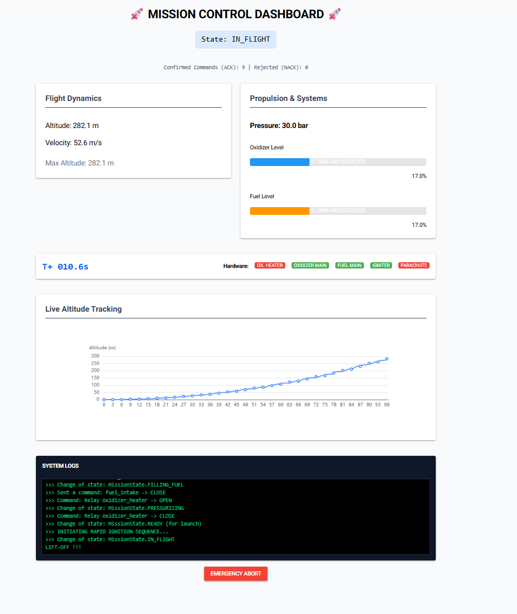
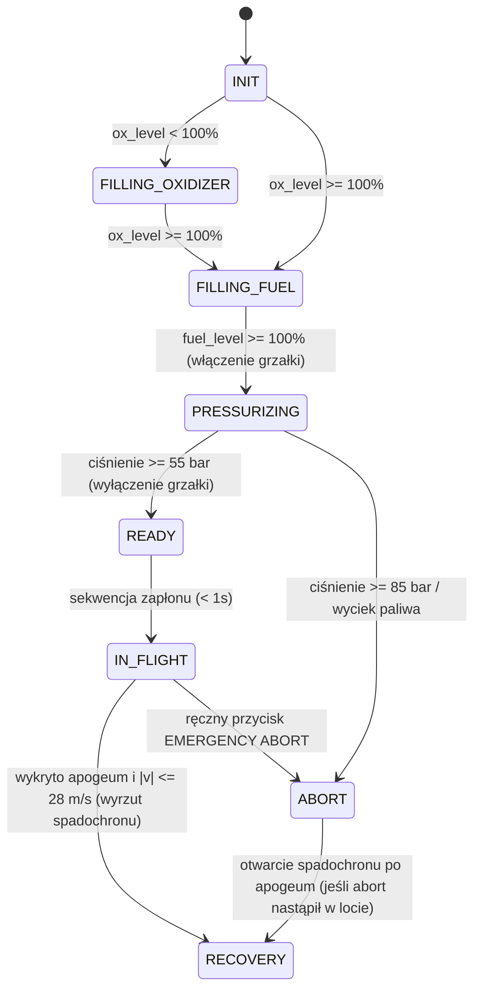
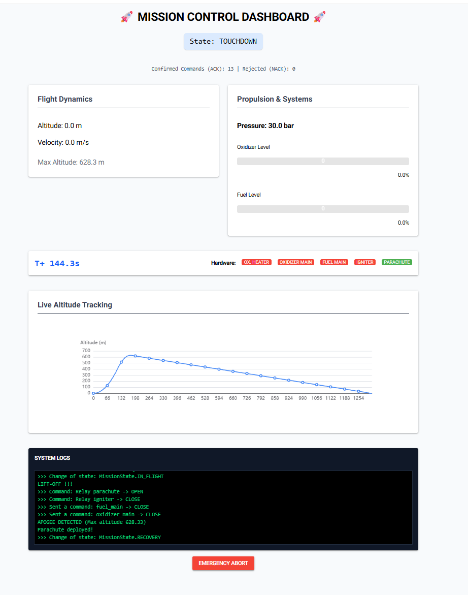

# Zadanie rekrutacyjne – AGH Space Systems (Rocket Software)

Aplikacja do obsługi lotu rakiety w symulatorze (`Mission Control` + webowy dashboard w `NiceGUI`). System automatycznie przeprowadza pełną procedurę: od tankowania utleniacza i paliwa, przez grzanie zbiornika i zapłon w oknie poniżej 1 sekundy, aż po wykrycie apogeum i bezpieczne lądowanie na spadochronie.



## Jak uruchomić projekt

Wymagany Python 3.10+. Wszystkie zależności znajdują się w pliku `requirements.txt`:

```bash
pip install -r requirements.txt
```

Do działania potrzebne są **3 osobne terminale** uruchomione w głównym folderze repozytorium:

**1. Uruchomienie serwera proxy:**
```bash
python tcp_proxy.py
```

**2. Uruchomienie symulatora rakiety:**
```bash
python tcp_simulator.py --feed-interval 0.2
```
*(Flaga `--feed-interval 0.2` zwiększa częstotliwość wysyłania ramek `FEED` z domyślnej 1 sekundy do 200 ms, dzięki czemu wykresy w GUI i obliczenia prędkości są dokładniejsze).*

**3. Uruchomienie Mission Control (do wyboru GUI lub sam terminal):**
* **Wersja z interfejsem graficznym (NiceGUI):**
  ```bash
  python ui.py
  ```
  Dashboard otworzy się w przeglądarce pod adresem `http://localhost:8000`.
* **Wersja konsolowa (bez GUI):**
  ```bash
  python mission_control.py
  ```

---

## Jak to działa pod spodem (Struktura kodu)

Zamiast pisać wszystko w jednym skrypcie, podzieliłem projekt na mniejsze moduły odpowiadające za konkretne zadania:

* **`client.py` (`TelemetricReceiver`)** – odbieranie ramek w osobnym wątku (`daemon=True`). Metoda `cm.receive()` z biblioteki komunikacyjnej jest blokująca (czeka na pakiet lub timeout). Gdyby była w głównej pętli programu, zatrzymywałaby maszynę stanów i uniemożliwiała np. szybkie wysłanie komend zapłonu. Osobny wątek w tle nasłuchuje pakietów `FEED`, `ACK` oraz `NACK` i na bieżąco aktualizuje stan rakiety.
* **`state.py` (`RocketState`)** – przechowuje aktualne odczyty z czujników oraz statusy potwierdzeń `ACK/NACK`. Ponieważ na pokładzie rakiety nie ma czujnika prędkości (a spadochron można otworzyć tylko poniżej 30 m/s), klasa liczy prędkość pionową przy każdym nowym odczycie wysokości ($v = \frac{\Delta h}{\Delta t}$) za pomocą `time.perf_counter()`. Tutaj też wykrywane jest apogeum – flaga `apogee_reached` ustawia się, gdy wysokość spadnie o min. 0.5 m poniżej dotychczasowego maksimum przy ujemnej prędkości (bufor 0.5 m chroni przed fałszywym wykryciem szczytu przez wahania numeryczne).
* **`interlocks.py` (`SafetyInterlocks`)** – blokady bezpieczeństwa sprawdzające fizyczny stan rakiety przed wysłaniem komendy:
  * blokada otwarcia zaworu paliwa (`fuel_intake`), dopóki utleniacz nie jest zatankowany do pełna,
  * blokada zapłonu, jeśli zbiorniki nie są pełne lub ciśnienie utleniacza jest poza bezpiecznym zakresem (40 – 64.5 bar),
  * blokada otwarcia spadochronu, gdy silnik jeszcze pracuje (`fuel_level > 0`) albo prędkość opadania przekracza 28 m/s (zostawione 2 m/s zapasu względem limitu 30 m/s z dokumentacji).
* **`mission_control.py` (`MissionControl` & `MissionState`)** – główna maszyna stanów (autopilot) oraz budowanie ramek `SERVICE`. Przy sekwencji zapłonu (`fuel_main` -> `oxidizer_main` -> `igniter`) oraz procedurze awaryjnej (`ABORT`) wywołuję `cm.send()` od razu po każdym `cm.push()`, ponieważ przy wrzuceniu kilku ramek naraz do kolejki pojedyncze wywołanie `send()` potrafiło gubić kolejne komendy przez sposób obsługi bufora TCP.
* **`ui.py`** – interfejs w NiceGUI odświeżany co 0.1 s (`ui.timer`). Wyświetla parametry lotu, poziom zbiorników, stan zaworów/przekaźników, licznik odebranych potwierdzeń `ACK/NACK`, wykres wysokości na żywo, logi systemowe oraz przycisk awaryjnego przerwania misji (`EMERGENCY ABORT`), który natychmiast zamyka wszystkie zawory.

---

## Przebieg lotu (Maszyna Stanów)

Autopilot przechodzi kolejno przez stany:





---

## Testy jednostkowe

W folderze `tests/` znajdują się testy jednostkowe (`pytest`) sprawdzające działanie blokad w `SafetyInterlocks`, wyliczanie prędkości i apogeum w `RocketState` oraz zliczanie ramek `ACK/NACK`.

Uruchomienie testów:
```bash
python -m pytest
```